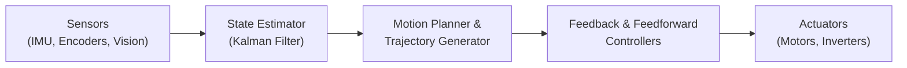

Welcome to my corner of the web!

I started this blog as an engineering notebook and publication space for deep dives into robotics, embedded intelligence, control systems, and data pipelines. As someone who works extensively on the physical-digital boundary—translating sensor streams into actuation and real-time decision making—much of my writing will explore first-principles engineering and system architecture.

Here is a quick look at what’s coming soon and the interactive technical features built directly into this reading experience.

---

## What to Expect

Upcoming series and standalone technical articles will focus on:

* **The Architecture of Autonomy:** A multi-part breakdown of end-to-end autonomous robot architectures, from perception pipelines and pose estimation to trajectory tracking and control theory.
* **Embedded Intelligence & Firmware:** Real-time operating systems, low-level microcontroller drivers (timers, interrupts, PWM), and hardware interfaces.
* **Control Theory in the Messy World:** Kalman filtering (EKF, UKF), state space modeling, gray-box system identification, and robust motion profiling.
* **Data Processing & Automation:** Architecting reliable data pipelines, automated report generation, and integrating LLM-assisted workflows.

---

## Technical Features of This Blog

Rather than publishing on generic platforms, this blog was built from scratch with tools tailored for engineering literature and scientific communication:

### 1. Mathematical Typesetting (KaTeX)
Complex equations and mathematical proofs are rendered natively in real time using $\LaTeX$ typesetting, supporting both inline formulas like $x(t) = x_0 + v_0 t + \frac{1}{2} a t^2$ and multi-line matrix expressions:

$$\mathbf{x}_{k} = \mathbf{F}_{k} \mathbf{x}_{k-1} + \mathbf{B}_{k} \mathbf{u}_{k} + \mathbf{w}_{k}$$

$$\mathbf{P}_{k} = \mathbf{F}_{k} \mathbf{P}_{k-1} \mathbf{F}_{k}^T + \mathbf{Q}_{k}$$

### 2. Interactive Architectural Diagrams (Mermaid.js)
System architectures, state machines, and control loops are defined programmatically as Markdown code blocks and rendered into crisp vector graphics:



### 3. Syntax-Highlighted Code
Code blocks are formatted with dark-mode syntax highlighting across C, Python, VHDL, TypeScript, and shell scripts:

```c
// Low-level PID + Feedforward motor controller step
float calculate_motor_voltage(float target_vel, float current_vel, float dt) {
    float error = target_vel - current_vel;
    integral_err += error * dt;
    float derivative_err = (error - last_err) / dt;
    last_err = error;

    float ff = (target_vel > 0.0f) ? kS + kV * target_vel : -kS + kV * target_vel;
    float fb = kP * error + kI * integral_err + kD * derivative_err;
    return clamp(ff + fb, -12.0f, 12.0f);
}
```

### 4. Zero-Jank Reading Progress Bar
As you scroll through any article, a minimal progress bar at the very top edge of the screen tracks your reading progress with zero layout thrashing or animation jank.

---

## Stay Tuned

The first full technical series, **The Architecture of Autonomy**, is currently being finalized in the draft room. In the meantime, feel free to explore my [Projects](/projects) and [Experiences](/experiences), or connect with me via [LinkedIn](https://linkedin.com/in/anivanchen) and [GitHub](https://github.com/anivanchen).
