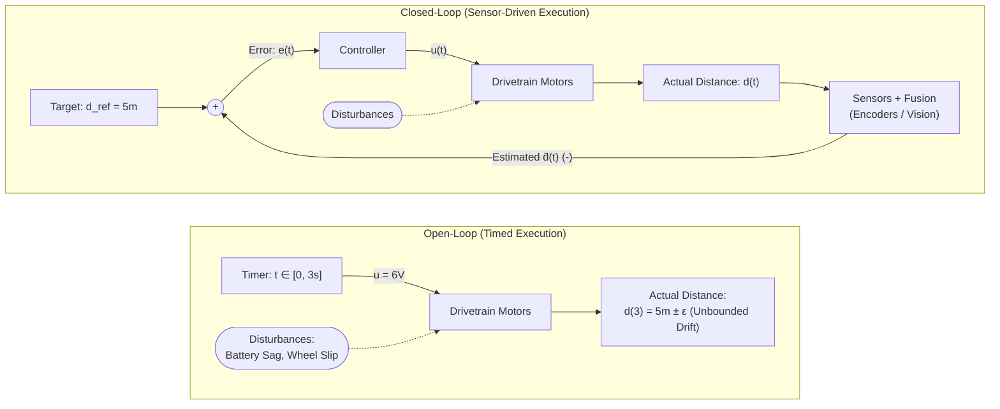
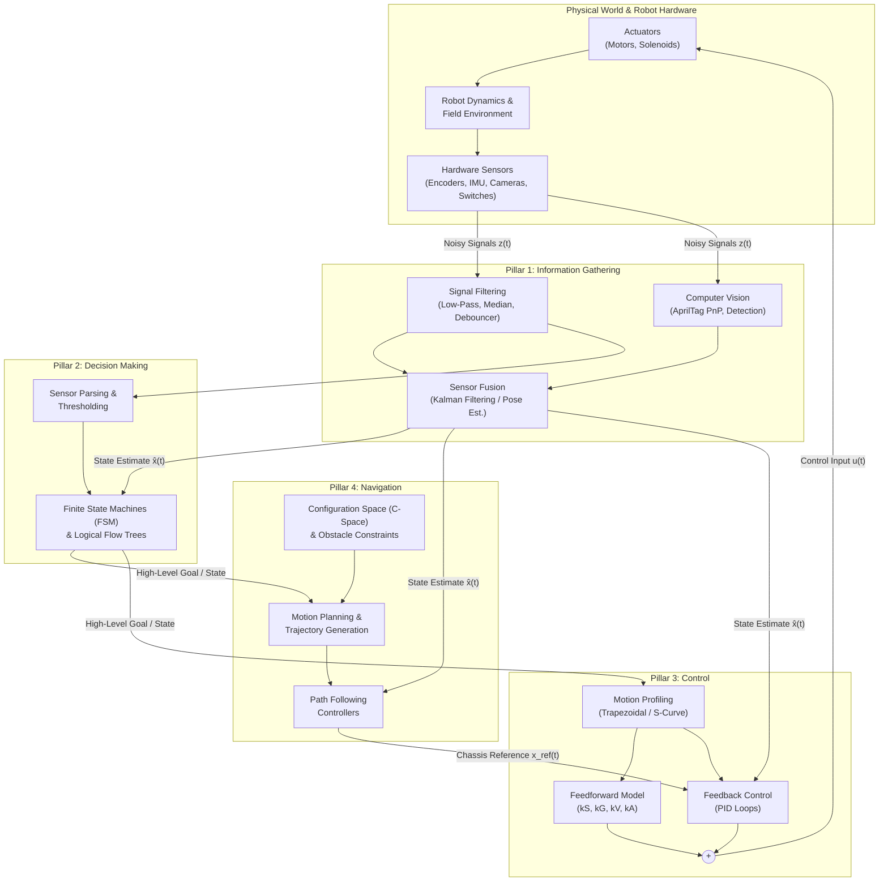

In 2023, I gave a presentation at StuySplash exploring the technologies behind successful autonomous functions in competition robotics, drawing on examples from StuyPulse’s robots and breaking down the workflow for designing automated systems from scratch.

While a single presentation can introduce the vocabulary of autonomy, building reliable autonomous software requires going a layer deeper into the math, signal processing, and control theory that actually make hardware move predictably.

This series expands that original guide into a multi-part technical deep dive. Before we get into sensor fusion, state machines, PID tuning, and path planning, **Part 0** establishes the mathematical motivation for *why* we automate and lays out how the **4 Pillars of Autonomy** fit together as a single closed-loop architecture.

---

## What is Automation, Formally?

At a high level, **automation** is a set of techniques that allow a system to operate with minimal human input.

In robotics and control engineering, we can be more precise. A robot is a continuous-time physical system interacting with an uncertain environment. At any time $t$, the robot has a true physical state vector $\mathbf{x}(t) \in \mathbb{R}^n$ (such as chassis pose, wheel velocities, and arm angles) governed by nonlinear dynamics:

$$\dot{\mathbf{x}}(t) = f\big(\mathbf{x}(t), \mathbf{u}(t), \mathbf{w}(t)\big)$$

where:
* $\mathbf{u}(t) \in \mathbb{R}^m$ is the vector of control inputs (such as motor voltages or current commands).
* $\mathbf{w}(t)$ represents unmodeled physical disturbances (carpet friction, battery voltage sag, gravity, or collisions with other robots).

Because the robot is inherently blind to $\mathbf{x}(t)$ on its own, it relies on sensors to produce an observation vector $\mathbf{z}(t)$ corrupted by measurement noise $\mathbf{v}(t)$:

$$\mathbf{z}(t) = h\big(\mathbf{x}(t), \mathbf{v}(t)\big)$$

**Manual operation** puts a human in the loop to visually estimate $\mathbf{x}(t)$ and manually generate $\mathbf{u}(t)$ via joysticks. **Automation** replaces or augments that human link with an algorithmic pipeline: estimating the state $\hat{\mathbf{x}}(t)$ from noisy measurements $\mathbf{z}(t)$, deciding on a target reference state $\mathbf{x}_{\text{ref}}(t)$, and computing the optimal control input $\mathbf{u}(t)$ to drive the error $\mathbf{e}(t) = \mathbf{x}_{\text{ref}}(t) - \hat{\mathbf{x}}(t)$ to zero.

---

## Why Automate?

In fast-paced environments like the FIRST Robotics Competition (FRC), a human driver is responsible for a massive checklist on every single scoring cycle: locate a game piece, drive to pick it up, navigate across the field, align to a scoring target, and actuate mechanisms to score.

While all of these actions *can* be performed manually, relying purely on human input introduces two major failure modes: **cycle-time bottlenecks** and **open-loop repeatability errors**.

### 1. Compressing Cycle Time & Cognitive Load

We can decompose a single scoring cycle time $T_{\text{cycle}}$ into four sequential or overlapping phases:

$$T_{\text{cycle}} = t_{\text{acquire}} + t_{\text{transit}} + t_{\text{align}} + t_{\text{score}}$$

When a robot is driven purely manually, two factors inflate $T_{\text{cycle}}$:
1. **Human Visuomotor Latency ($\tau_h$):** Human reaction time typically sits between $150\text{ ms}$ and $300\text{ ms}$. Every time a driver waits to visually confirm that a game piece has entered an intake before starting to turn, or overshoots a scoring peg and has to micro-adjust, those latencies compound.
2. **Sequential vs. Parallel Execution:** A human driver has limited bandwidth. It is difficult to manually feather an elevator height, spin up a shooter flywheel, and strafe around a defender while keeping a turret locked onto a goal simultaneously.

Full autonomy is difficult to achieve in chaotic environments, but **semi-autonomous functions** allow the driver to offload high-precision tasks—like snapping to an AprilTag scoring pose or auto-indexing a game piece the millisecond a beam-break sensor trips. By running mechanism state transitions in parallel with chassis movement and eliminating human micro-alignment, teams drastically reduce $t_{\text{align}}$ and $t_{\text{score}}$, directly increasing the total number of cycles per match:

$$N_{\text{cycles}} = \left\lfloor \frac{T_{\text{match}}}{T_{\text{cycle}}} \right\rfloor$$

### 2. The Failure of Blind Open-Loop Commands

Even when we remove the human driver, naive "automation" without sensor feedback is fragile.

Consider the difference between a blind, time-based command and a sensor-driven command:
* **Blind (Open-Loop):** *"Run motors 1, 2, 3, and 4 at 6 volts for 3 seconds."*
* **Sensor-Driven (Closed-Loop):** *"Run motors 1, 2, 3, and 4 until the robot has traveled a distance of 5 meters."*

Why does the timed command fail in practice? Using a standard DC motor and drivetrain model, the steady-state velocity $v(t)$ of the chassis for a commanded duty cycle $\alpha \in [-1, 1]$ depends on the live battery voltage $V_{\text{batt}}(t)$ and the resistive force $F_{\text{load}}(t)$ from friction and carpet resistance:

$$v(t) = \frac{1}{k_V} \left( \alpha V_{\text{batt}}(t) - k_S \operatorname{sgn}(v) - k_A a(t) \right) - w_{\text{slip}}(t)$$

When you integrate velocity over a fixed duration $T = 3\text{ s}$ without feedback, your final position is:

$$d(T) = \int_{0}^{T} v(t)\,dt$$

If your battery is fresh in a practice match ($V_{\text{batt}} = 12.6\text{ V}$), the robot might travel $5.3\text{ m}$. In an elimination match with a worn battery under heavy load ($V_{\text{batt}} = 11.2\text{ V}$) or wheels skidding on worn carpet ($w_{\text{slip}} > 0$), that exact same code will leave the robot short at $4.6\text{ m}$. Because errors are integrated over time with zero correction, position variance $\sigma_d^2(t)$ grows monotonically with time.

Information gathering and closed-loop control bound this uncertainty, making robot behavior reproducible across different batteries, fields, and match conditions.

---

## The 4 Pillars of Autonomy: System Architecture

To turn a blind mechanical assembly into a reproducible autonomous system, we break the software stack into 4 Pillars of Autonomy: **Information Gathering**, **Decision Making**, **Control**, and **Navigation**.

These four pillars do not exist in isolation; they form a continuous, real-time feedback loop running at $50\text{–}1000\text{ Hz}$ on the robot's processor:

---

## What to Expect in This Series

Each upcoming post in this series tackles one pillar of the diagram above, combining practical FRC case studies from StuyPulse with the underlying math and algorithms you need to implement them yourself:

### Part 1: Information Gathering — Teaching Blind Robots to See
How does a robot measure its own state and the world around it?
* **The Sensor Suite:** Encoders (relative vs. absolute), IMUs, proximity/break-beam sensors, color sensors, and distance sensors (Ultrasonic, IR, LiDAR).
* **Computer Vision & Fiducials:** Moving from retroreflective tape to 3D localization with AprilTags, including a real-world case study on distance-based covariance scaling from StuyPulse’s 2023 robot, Jim.
* **Multi-Rate Sensor Fusion:** Why combining a fast, drifting $20\text{ ms}$ encoder stream with a slow, absolute $100\text{ ms}$ camera stream beats either sensor alone.
* **Signal Filtering & Phase Lag:** The math and trade-offs of Moving Average, Median, Low-Pass/High-Pass filters, Slew Rate Limiters, and binary Debouncers.

### Part 2: Decision Making — Finite State Machines & Logical Flow
Once we have clean state estimates $\hat{\mathbf{x}}(t)$, how does the robot decide what to do next?
* **Discretizing Sensor Spaces:** Turning continuous RGB/HSV color streams and analog distances into reliable boolean triggers.
* **Finite State Machines (FSMs):** Formalizing mechanism states, state transitions, and inter-mechanism triggers so intakes, indexers, and shooters work in lockstep without race conditions.
* **Logical Flow Diagrams:** Designing and visualizing complex decision trees before writing a single line of robot code.

### Part 3: Control Theory — Fighting Friction, Gravity, and Inertia
How do we convert a desired target state into exact motor voltages?
* **Motion Profiling:** Constraining velocity and acceleration with trapezoidal and S-curve profiles so mechanisms move smoothly without mechanical shock.
* **Physics-Based Feedforward (Open-Loop):** Modeling static friction ($k_S$), gravity ($k_G$), velocity back-EMF ($k_V$), and acceleration inertia ($k_A$).
* **Closed-Loop Feedback (PID):** Driving tracking error to zero in the presence of real-world disturbances.
* **System Identification (SysId):** Empirically characterizing your hardware from voltage step-response tests rather than guessing gains by hand.

### Part 4: Navigation — From Dead Reckoning to Path Following
How do we move the entire robot safely and accurately across a field or through a multi-dimensional workspace?
* **Odometry & Dead Reckoning:** Kinematics integration and why wheel skid ruins pure encoder + gyro odometry.
* **Pose Estimation:** Fusing visual odometry and AprilTags with drivetrain odometry for centimeter-level field localization.
* **Configuration Space ($\mathcal{C}$-Space):** Representing $1\text{-DOF}$ elevators, $2\text{-DOF}$ jointed arms, and swerve drivetrains as points in $\mathcal{C}$-space to guarantee collision-free motion.
* **Motion Planning & Path Following:** Generating smooth trajectories from Point A to Point B and tracking them in real time.

### Part 5: Systems Engineering — An 8-Step Playbook for Designing Your Own
We’ll wrap up the series with an end-to-end engineering checklist: how to identify what should be automated, collaborate with mechanical/electrical subteams on sensor placement, diagram state logic, run SysId, and debug edge cases under real competition pressure.

---

Ready to dive in? Stay tuned for **Part 1: Information Gathering** to explore how raw electrical signals and camera pixels become actionable robot state estimates.
