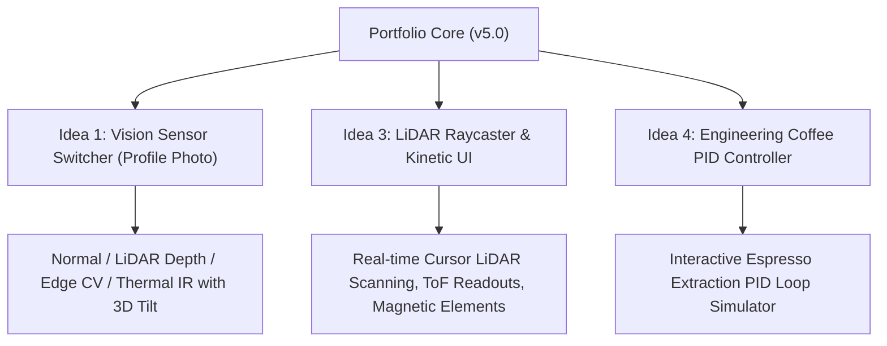
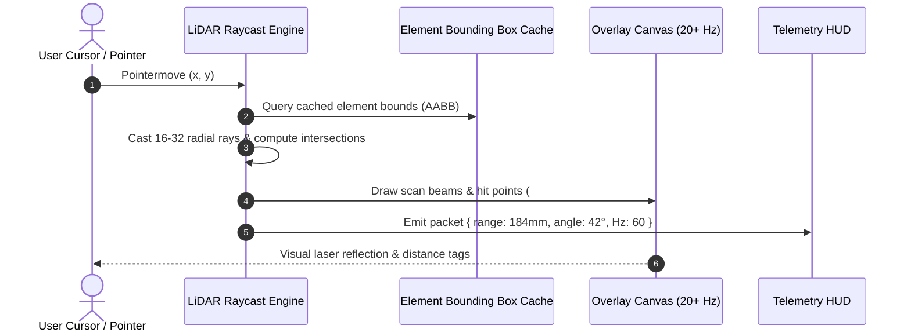
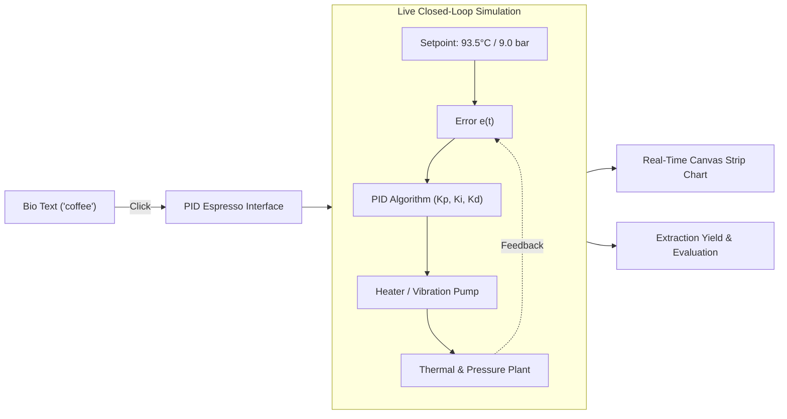
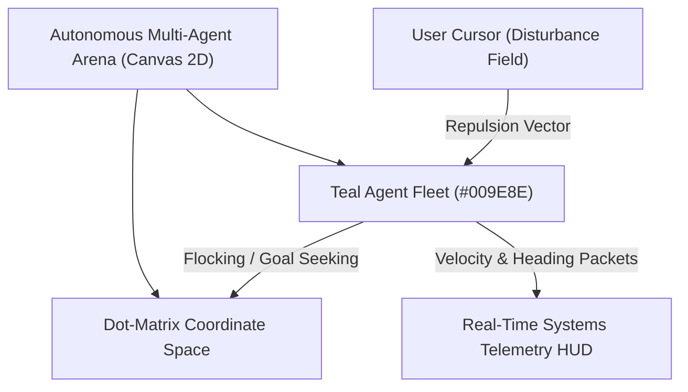
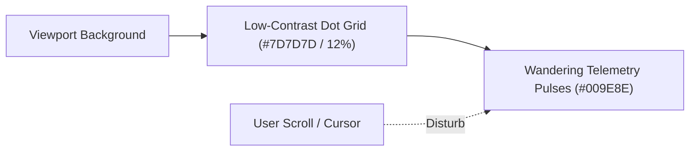
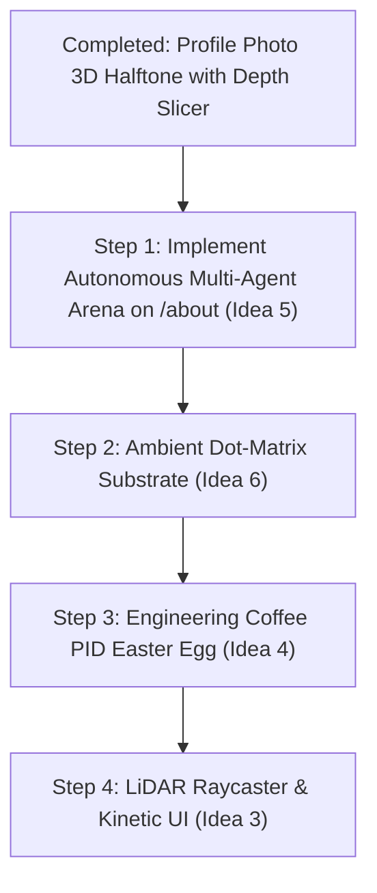

# ivanchen.dev — Milestone Report & Interactive Features Expansion

This document summarizes everything implemented to date for Ivan Chen's portfolio redesign, documents **Ideas 1, 3, and 4**, and presents an **in-depth expansion on Ideas 3 and 4**.

---

## Part 1: What We’ve Done

### 1. Visual Redesign & Design Token Foundation
- **Figma Redesign Alignment**: Fully implemented Frames 1–4 from the redesign specifications (`redesign/Frame 1-4.png`).
- **Typography**: Installed and configured **Cal Sans** (`font-cal`, 600 weight) for headings and branding, paired with **Inter** for clean body readability.
- **Design Tokens**:
  - Brand Teal: `#009E8E`
  - Dark Charcoal: `#2E3435`
  - Muted Gray: `#7D7D7D`
  - Surface Fill: `#F4F4F4`
  - Pure White: `#FFFFFF`
- **Global Scrollbar Suppression**: Completely hid scrollbars across all browsers, viewports, and operating systems while maintaining smooth touch and wheel scrolling.

### 2. Desktop & Mobile Architecture
- **Desktop Sidebar (`hidden lg:flex`)**:
  - Full viewport height (`lg:h-screen lg:max-h-screen lg:sticky lg:top-0`).
  - Strict non-scrolling constraint (`overflow-hidden`), housing the site title, profile image, greeting, navigation links, and copyright.
- **Mobile Sliding Header (`lg:hidden`)**:
  - Replaced abrupt modal pop-ups with a unified expanding `<header>` that slides down to fill the viewport (`h-16` to `100dvh`) with an extended **500ms `ease-in-out`** transition.
  - Positioned "Ivan Chen" in the exact same top-bar coordinate whether collapsed or expanded, eliminating layout shift.
  - Interactive hamburger button whose 3 SVG lines smoothly morph into an `✕` close icon with synchronized `ease-in-out` kinematics.

### 3. Profile Image & Card Proportion Fixes
- **Strict 1:1 Aspect Ratio**: Eliminated asymmetrical `max-h` constraints that previously squished the profile picture into a landscape rectangle on mobile.
- **Greeting Row Alignment**: Sized the mobile card to `w-[280px] sm:w-[320px] aspect-square` and added `whitespace-nowrap shrink-0` to `"Nice to meet you!"`, ensuring the text and social links stay strictly on a single line with zero wrapping or overflow.

### 4. Routing & Content Pages
- **About (`/` & `/about`)**: Full bio with links to RIT, RVTech, and NYC OMB. Updates section featuring identical 1px solid `#7D7D7D` dividers.
- **Experiences (`/experiences`)**: Detailed career history with links to Rivian/VW Group Tech, NYC OMB, RIT TA, and StuyPulse.
- **Projects (`/projects`)**: Up-to-date resume projects with images commented out, including the newly added `stuyspec.com (2023)` link and description.
- **Blog Engine (`/blog` & `/blog/:slug`)**:
  - **Data Architecture**: Standalone `.md` files in `app/data/` with custom zero-dependency YAML frontmatter extraction.
  - **LaTeX Support**: Inline `$..$` and display `$$..$$` rendered via KaTeX.
  - **Intelligent LaTeX Clipboard Copy**: Intercepts copy events to extract the raw MathML `<annotation>` source, placing clean LaTeX code into the clipboard instead of broken visual characters.
  - **Syntax Highlighting**: Integrated `highlight.js` with GitHub Dark Dimmed styling, language badges, and dark card containers.
  - **Mermaid Diagrams**: Client-side dynamic rendering with custom brand theme tokens and minimum width enforcement to prevent text from shrinking into illegible glyphs.
  - **Tag Filter Bar**: Dynamic alphabetical tag filtering at the top of `/blog` synced with `useSearchParams` (`?tag=...`) and interactive card tags.
  - **Divider Normalization**: Unified all horizontal rules (`
`, markdown `---`, and footer dividers) to consistent 1px solid `#7D7D7D` lines.

### 5. Profile Picture: 3D Editorial Halftone Dot Matrix with Depth Slicing
- **Halftone 3D Parallax Canvas**:
  - High-density sampling ($96 \times 96$ grid, ~5,500 active dots) mapped against 1120×1120 color photo (`/pfp.webp`) and 768×768 depth map (`/pfp-depth.webp`).
  - Precomputes halftone dot radii with zero runtime `Math.pow()` calls in the render loop.
  - Sub-millisecond rendering ($< 0.25\text{ms}$ per frame) using batched single-path `ctx.arc()` operations.
- **Range-Gating Depth Slicer (Z-Slider)**:
  - Vertical frosted slider pill centered on the left edge (`left-2.5 top-1/2 -translate-y-1/2`, $w=7$).
  - Linear range gating mapping ($z_{\text{cutoff}} = \text{pos} \times 0.475$).
  - Soft dissolution edge ($0.04$ margin) for smooth, progressive slicing.
  - Direct DOM style mutations bypass React re-rendering for zero-latency 120 FPS dragging and wheel scrolling.
- **Subject Isolation & Visual Hierarchy**:
  - Background dots calibrated to be 20% smaller ($0.80$ scale) than foreground subject dots ($1.00$ scale).
  - Smooth Hermite S-curve interpolation ($3t^2 - 2t^3$) harmonized across the slider cutoff bounds ($0.0$ to $0.475$).
- **Controls & Navigation Integration**:
  - Single mode switcher pill (`Matrix` ⇄ `Photo`) in the top-left corner (`top-2.5 left-2.5`, $h=7$, $px=2.5$).
  - Shared $28\text{px}$ cross-axis geometry across both top-left pill and left-side slider.
  - Passive continuous cursor tracking on `window` seeds initial 3D tilt before transition so the 700ms crossfade begins in natural 3D perspective without abrupt jerks.
  - Initial 5-second auto-transition to matrix mode on page load (cancelled if user manually toggles).
- **Architectural Refinement (Separation of Concerns)**:
  - Evaluated and subsequently removed in-avatar swarm agents to avoid visual overload and maintain clean editorial focus on the portrait.
  - Decision made to extract the dot matrix and reactive teal agents to larger, dedicated surfaces elsewhere on the website.

### 6. Git Milestone
- Created an atomic commit for the portfolio redesign (`3f7b1e5`: *"Redesign portfolio: layout, about, experiences, and projects"*).

---

## Part 2: Documentation of Ideas 1, 3, and 4

### Idea 1: Interactive Vision Sensor Switcher (Profile Photo)
- **Concept**: Transform Ivan's profile picture from a static image into an interactive robotics sensor feed with a sleek mode switcher pill underneath.
- **Modes**:
  1. **Normal**: Crisp color photo (`/pfp.jpg`).
  2. **LiDAR Depth Map**: High-contrast teal depth gradient with animated laser scan lines and depth contour overlays.
  3. **Computer Vision (Sobel Edge Detection)**: Edge-filtered wireframe lines inspired by OpenCV AprilTag localization pipelines.
  4. **Thermal IR**: False-color heatmap inspired by EV inverter thermal testing at Rivian.
- **3D Parallax Tilt**: Mouse hover triggers smooth 3D card tilt (`perspective: 1000px`, `rotateX`, `rotateY`) with dynamic light reflection.

### Idea 3: Interactive LiDAR Point Cloud Raycaster & Kinetic UI
- **Concept**: Turn the browser viewport into an active perception environment.
- **Mechanics**: Moving the cursor casts virtual LiDAR beams that detect DOM element boundaries, displaying real-time distance measurements, laser hit points, and telemetry packets.
- **Kinetic UI**: Magnetic attraction on interactive tags (`<Robotics>`, `<Controls>`) that pull smoothly toward the cursor on hover.

### Idea 4: "Engineering Coffee" PID Controller Easter Egg
- **Concept**: A playable engineering simulation inspired by Ivan's bio: *"Sometimes I bring a little bit of engineering magic back into making coffee."*
- **Mechanics**: Clicking "coffee" in the bio reveals an embedded espresso machine PID controller widget. Users adjust $K_p$, $K_i$, and $K_d$ to control water temperature and pump pressure, pulling a virtual espresso shot evaluated by control stability and taste profile.

---

## Part 3: Deep Dive & Expansion on Idea 3 (LiDAR Raycaster & Kinetic UI)

### 1. Functional Architecture
- **Laser Beam Sweep**: The cursor acts as a simulated 2D planar LiDAR sensor (similar to an RPLiDAR or Velodyne unit). It fires 16 to 32 radial rays across 360° (or an active 120° forward cone following pointer velocity).
- **Ray-Box Intersection**:
  - The engine indexes visible content cards, headings, and images as 2D Axis-Aligned Bounding Boxes (AABB).
  - Ray-segment intersection computes the exact point where each laser hits a UI element.
  - Hit points render as glowing `#009E8E` teal point-cloud dots that briefly persist and decay with an exponential fade.
- **Real-Time Distance HUD**:
  - A small, non-intrusive floating HUD widget in the bottom corner (e.g. `LIDAR [ON]  •  RANGE: 218mm  •  POINTS: 32  •  UDP 60Hz`).
  - Clicking the HUD or pressing `L` toggles the scanner on/off.

### 2. Kinetic Spring Physics (Magnetic Elements)
- **Magnetic Tags & Links**:
  - When the cursor enters a 30px radius around tags like `<Robotics>` or nav links, the element calculates the delta $(\Delta x, \Delta y)$ and translates toward the cursor using a damped spring algorithm:
    $$F = -k \cdot x - c \cdot v$$
  - When the cursor exits, the element springs back into place with subtle elastic settling.

### 3. Performance & Battery Optimization
- **`requestAnimationFrame` Throttling**: Renders only when the cursor is in motion.
- **Zero Layout Thrashing**: Bounding rectangles are measured once during page resize/scroll and cached in a flat array, avoiding repetitive `getBoundingClientRect()` reflows.
- **Graceful Mobile Degradation**: On touchscreens, the raycaster automatically swaps to a touch-activated radar pulse or turns off to save mobile battery.

---

## Part 4: Deep Dive & Expansion on Idea 4 ("Engineering Coffee" PID Controller)

### 1. Narrative & UX Integration
- In the bio on `app/routes/about.tsx`:
  > *"Sometimes I bring a little bit of engineering magic back into making coffee."*
- Hovering over `coffee` displays a subtle steam particle effect and turns the text `#009E8E`.
- Clicking it opens an embedded retro-industrial PID controller modal styled like a boutique dual-boiler machine (e.g., La Marzocco / Decent DE1 / Gaggiuino).

### 2. The Mathematical & Physical Model
The simulator runs a discrete-time Euler integration loop at 60 Hz:

$$u(t) = K_p \, e(t) + K_i \sum_{0}^{t} e(\tau)\Delta\tau + K_d \, \frac{e(t) - e(t - \Delta t)}{\Delta t}$$

- **State Variables**:
  - **Current Temp $T(t)$**: Target setpoint $T_{\text{target}} = 93.5^\circ\text{C}$.
  - **Grouphead Pressure $P(t)$**: Target setpoint $P_{\text{target}} = 9.0\text{ bar}$.
  - **Thermal Mass & Heat Loss**: Ambient room temperature ($22^\circ\text{C}$), water thermal capacity, and heating element wattage ($1200\text{W}$).
  - **Puck Resistance**: Simulates coffee puck saturation, channeling, and declining resistance during extraction.

### 3. Interactive Controls & Live Graph
- **Three Precision Sliders / Rotary Dials**:
  - $K_p$ (Proportional Gain): Fast response vs. violent oscillation.
  - $K_i$ (Integral Gain): Eliminates steady-state offset vs. causing integral windup.
  - $K_d$ (Derivative Gain): Dampens temperature overshoot vs. noise amplification.
- **"Brew Shot" Button**:
  - Initiates a 28-second extraction cycle.
  - A real-time dual-line canvas graph plots **Temperature** (teal) and **Pressure** (charcoal) against their setpoints.
  - Animated espresso cup fills with rich, dark crema.

### 4. Shot Evaluation Engine
At the end of the shot, the system evaluates the root-mean-square tracking error ($\text{RMSE}$) and integral absolute error ($\text{IAE}$):

| Tuning Condition | Control Behavior | Shot Evaluation Result |
| :--- | :--- | :--- |
| **Well-Tuned PID** | Settles smoothly within $\pm 0.3^\circ\text{C}$ and 9 bar | 🌟 *"God Shot: Balanced extraction, velvety crema, bright sweetness!"* |
| **High $K_p$, Low $K_d$** | Wild temperature oscillation ($> \pm 4^\circ\text{C}$) | ⚠️ *"Overheated & Channeling: Bitter, scorched taste profile."* |
| **Low $K_i$** | Steady-state error (settles at $87^\circ\text{C}$) | 🍋 *"Under-extracted: Sour, flat, lacking body."* |
| **High $K_i$ (Windup)** | Huge overshoot to $99^\circ\text{C}$ with boiling steam | 💥 *"Thermal Windup: Steam pressure blown! Piston vented."* |

---

## Part 5: Deep Dive on Idea 5 (Autonomous Multi-Agent Arena on `/about`)

### 1. Narrative & Technical Context
In the bio on `app/routes/about.tsx`:
> *"I work a lot on end-to-end automation, whether that be robots, cars, or data pipelines. I specialize in systems design, control theory, data processing, and embedded intelligence. My work lives a lot on the physical-digital boundary, using data to drive decision making and produce actions in the real and messy world."*

Rather than an isolated gimmick, the **Autonomous Multi-Agent Arena** serves as a direct, tangible demonstration of Ivan's work in robotics, control loops, and multi-agent systems.

### 2. Functional Architecture & Mechanics
- **Canvas Stage**: A wide, sleek, high-density dot matrix canvas placed between the bio narrative and the Updates section.
- **Teal Autonomous Agents**:
  - A swarm of autonomous vehicles / agents represented as glowing `#009E8E` teal nodes with subtle heading indicators or motion tails.
  - **Nominal State (Patrol / Flocking)**: Agents cruise the dot matrix, performing decentralized pathfinding and area coverage while maintaining separation ($F_{\text{repel}} \propto 1/r^2$).
  - **Disturbance Reaction (Cursor Evasion)**: When the visitor moves their pointer into the arena, it acts as a dynamic obstacle / danger zone. Agents calculate repulsion vectors:
    $$\vec{F}_{\text{evade}} = -\sum_{i} \frac{k}{(\|\vec{p}_i - \vec{p}_{\text{cursor}}\|^2)} \, \hat{u}$$
    causing them to scatter organically, curve around boundary constraints, and reform patrol formations once the disturbance subsides.
- **Telemetry HUD**:
  - Minimalist hardware-inspired readouts embedded in the canvas frame: `AGENTS: 24  •  AVG VEL: 142 mm/s  •  COLLISIONS: 0  •  LOOP: 120 Hz`.

### 3. Performance & Battery Guarantees
- Two-batch rendering in Canvas 2D keeps draw time under $0.3\text{ms}$ per frame.
- An `IntersectionObserver` halts all physics calculations and `requestAnimationFrame` cycles when the card scrolls out of the viewport (0% CPU).

---

## Part 6: Deep Dive on Idea 6 (Ambient Dot-Matrix Substrate)

- **Concept**: A unified architectural background texture across the entire portfolio.
- **Mechanics**: Faint, crisp dots ($0.75\text{px}$ radius, 12% opacity) form a background matrix. Low-density teal packets travel across empty gutters and margins, subtly reacting when the user hovers near page edges, making the entire website feel like an active autonomous testbed.

---

## Implementation Roadmap

1. **Milestone Completed**: Profile photo 3D halftone with linear depth slicer, Hermite subject scaling, and 5-second auto-transition.
2. **Current Sprint (Step 1)**: Build the **Autonomous Multi-Agent Arena** directly on `app/routes/about.tsx`.
3. **Subsequent Sprints**: Integrate the **Ambient Dot-Matrix Substrate** and **Engineering Coffee PID Simulator**.
